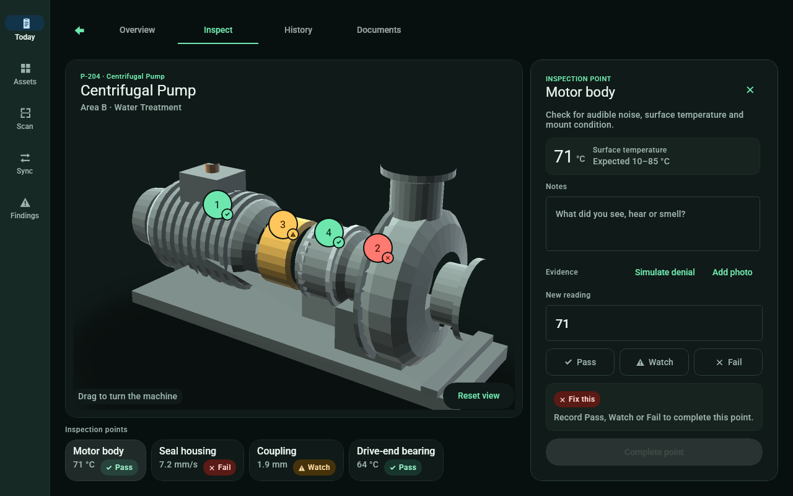

# TRACE

- **Owner:** Matthew Mattei (@noknowscode)
- **Status:** ready for review
- **What it is:** Spatial equipment inspection for maintenance technicians: readings, photos and corrective work on a 3D machine, offline first.

Field-first maintenance and inspection for technicians who work on pumps, compressors and air handlers, built with
Uno Platform. The machine is the way in: each asset opens on a 3D view of the equipment with its inspection points
pinned to it. At a point the technician reads the last value and its expected range, enters a new reading, calls
Pass, Watch or Fail, adds a note or photos, and raises corrective work from a failure. A supervisor dispatches and
closes that work from Findings. Everything is saved on the device first and queued for sync.



## What it shows

- **Today:** the assigned round, each asset with its condition, progress, due time and open findings.
- **Asset workspace:** Inspect (the machine, its points and the point inspector), Overview, History with the photos
  recorded at each inspection, and Documents (nameplate and inspection plan).
- **Inspection:** reading validation, Fail needs a note or a photo, an out-of-range reading asks for an explicit
  call, the draft is kept while you move around, and one corrective action per failed inspection.
- **Assets, Scan, Sync, Findings:** search, open by tag or typed code, the offline queue with retry, and dispatch.
- **Responsive:** a bottom bar on a phone and a rail from 600 px; the inspector is a sheet below 800 px and docks
  from 800 px. Dark by default, with a Light theme for office review.

The camera, the tag scanner, the network and the sync transport are deterministic simulations behind interfaces in
`Trace/Services/`, so the app runs on its own. There is no server.

## Stack

Uno.Sdk 7.0.0-dev.115 (a preview, pinned in `global.json`), .NET 10, MVUX, Navigation Extensions, the Uno Toolkit,
Material with a colour override, and SkiaSharp for the equipment view. Heads: desktop (Windows, macOS, Linux),
WebAssembly, Android, iOS and Windows App SDK.

## Try it

You need the .NET 10 SDK, and the `wasm-tools` or `android` workload for those heads.

```bash
# Desktop
dotnet run --project Trace/Trace.csproj -f net10.0-desktop -p:TraceTargetFrameworks=net10.0-desktop

# WebAssembly: publish, then serve wwwroot
dotnet publish Trace/Trace.csproj -f net10.0-browserwasm -c Release -p:TraceTargetFrameworks=net10.0-browserwasm -o publish/wasm
python3 -m http.server 8765 --directory publish/wasm/wwwroot

# Android, on a connected device or emulator
dotnet build Trace/Trace.csproj -f net10.0-android -p:TraceTargetFrameworks=net10.0-android -t:Run
```

A first launch seeds three assets (P-204, AHU-12, C-07) and a round for today. Open **Centrifugal Pump** and press
**Seal housing** to start an inspection.

## Tests

This folder holds the one app project Studio opens. The unit tests (176: the domain rules, the store, the workflows,
the sync order and every page model) live in the development repository,
[noknowscode/trace](https://github.com/noknowscode/trace).

## Layout

| Path | What |
|---|---|
| `Trace/` | the app: `Domain/`, `Services/`, `Infrastructure/`, `Presentation/` (pages, models, controls, the 3D pipeline in `Scene3D/`), `Themes/` |
| `docs/` | the product specs, the completion checklist, decisions, the audits and runtime evidence |
| `prototype/` | the HTML interaction reference the app was built from |
| `tools/` | runtime verification scripts (desktop under Xvfb, the screenshot matrix, the WebAssembly check) |

`CLAUDE.md` has the architecture rules and the verification hooks; `docs/COMPLETENESS.md` says what is done and
what is open.
