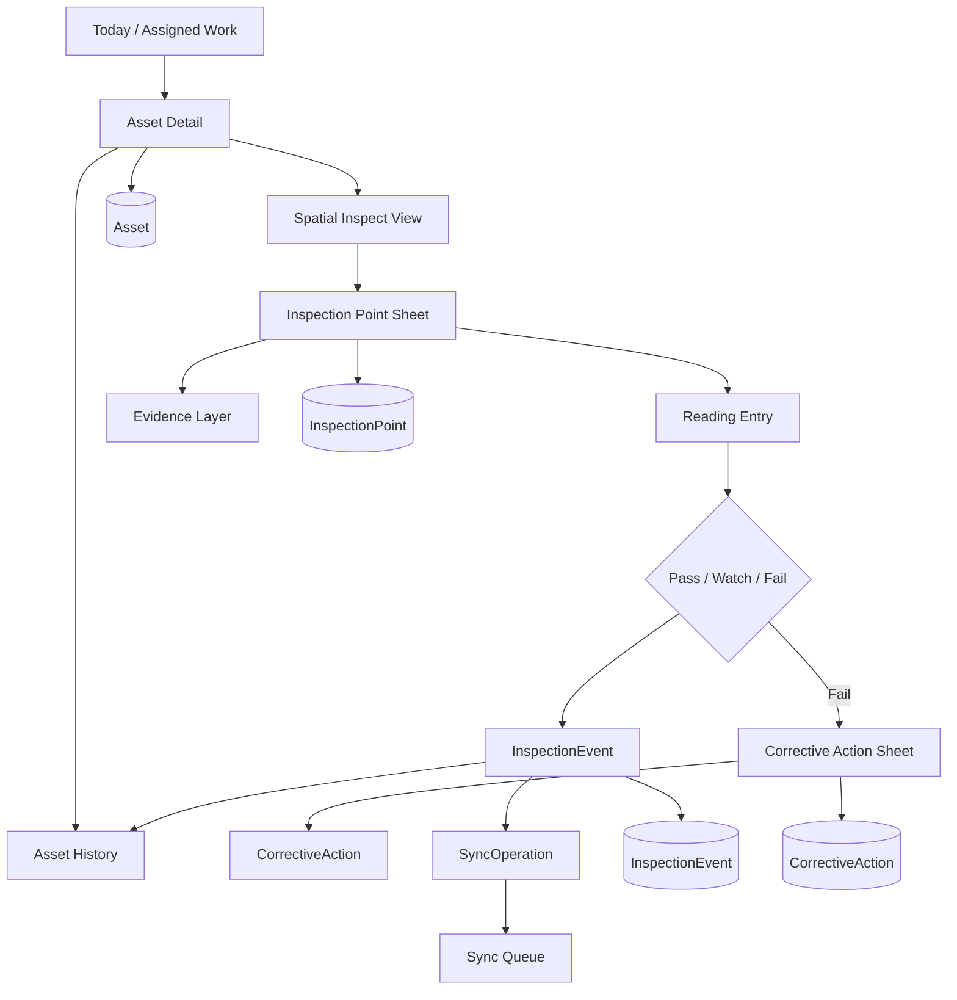

# TRACE — Implemented Design Graph

## Core design tokens
- Base spacing: 4 / 8 / 12 / 16 / 24 / 32
- Field body: 15px
- Labels: 12–13px
- Display asset title: 22–28px
- Corner radius: 10px controls, 14px sheets, 18px cards
- Status roles: neutral / success / watch / failure / syncing
- Surface hierarchy: canvas → raised pane → interactive tile → transient sheet

## Reusable patterns
- Asset header
- Spatial point marker
- Reading capsule
- Status segmented control
- Evidence tile
- Timeline event
- Sync status chip
- Action confirmation toast

## Interaction patterns
- Tap spatial marker → reveal point sheet
- Enter reading → live range evaluation
- Disposition → update point state
- Fail → corrective-action path
- Offline → immediate local commit + queued sync
