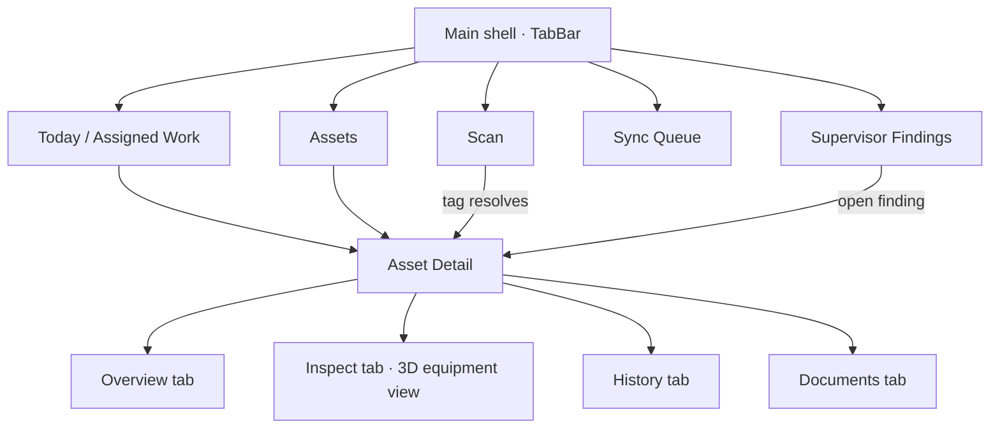
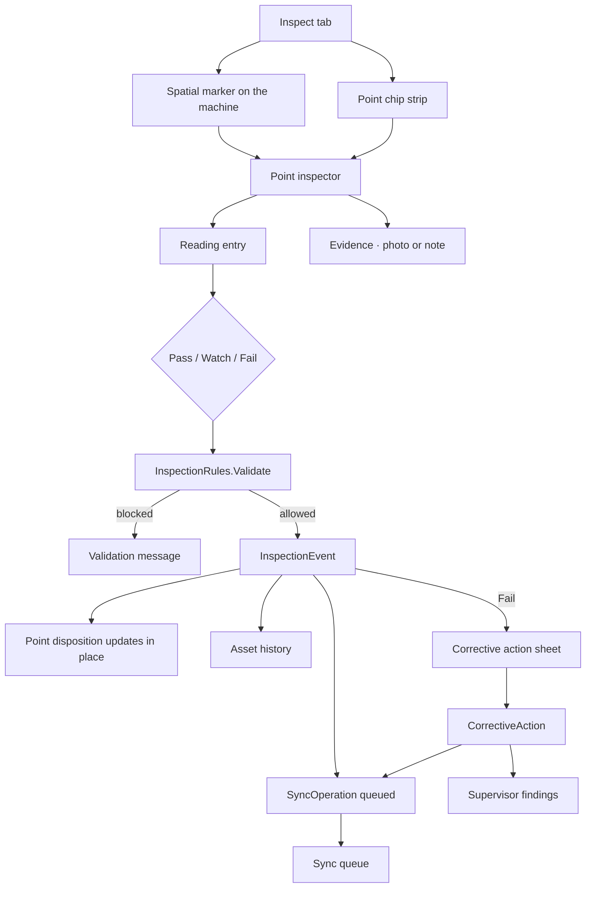

# TRACE — Implemented Design Graph

This records what the Uno app actually implements. Where it departs from the original
product package, the deviation is called out under "Deviations from the brief".

## Navigation

The shell is a single `TabBar` that changes orientation with width: a left rail at
workstation width, a bottom bar on a handheld. All five destinations are direct — there is
no "More" overflow.

## Inspection flow

The inspector is one control, `PointInspector`, presented two ways: docked as a right-hand
panel at workstation width, and as a bottom sheet below it. Reading entry, the three
dispositions, the validation message and Complete point live in a pinned footer so the
decision is never below the fold.

## The equipment view

The Inspect tab draws a real 3D model of the asset, not an illustration:

- Parametric solids (revolve, box, tube, ring) build a pump, air handler and compressor,
  cached per `AssetKind`.
- An orbit camera frames the model by fitting its projected outline to the viewport, so the
  machine fills a phone panel and a desktop one equally.
- Lambert key light plus fill, sky and rim terms; backface culling; painter's-algorithm
  triangle sort; one `DrawVertices` call into a 2× supersampled surface.
- Rendered through `SKXamlCanvas` rather than a GL surface, because Android is a Tier 1
  target and Uno's GL canvas is desktop and Windows only.
- Inspection points are 3D anchors on the solids. The renderer publishes where each one
  projected to, and a `NonVirtualizingLayout` places the XAML markers there, dimming the
  ones that turned to the far side. The markers stay ordinary focusable controls so the
  points remain reachable by keyboard and screen reader.

## Core design tokens

- Base spacing: 4 / 8 / 12 / 16 / 24 / 32
- Field body: 15px
- Labels: 12–13px
- Display asset title: 22–28px
- Corner radius: 10px controls, 14px sheets, 18px cards
- Status roles: neutral / success / watch / failure / syncing
- Surface hierarchy: canvas → raised pane → interactive tile → transient sheet
- Minimum touch target: 44px

Colour comes from the Material theme with a DSP palette override. Both themes are
first-class; dark is the default for field use. Text roles carry their colour through Style
setters rather than local `ThemeResource` assignments, which do not re-resolve on a theme
change.

## Reusable patterns

- Page header (eyebrow / title / supporting / actions)
- Asset card
- Spatial point marker
- Reading capsule
- Disposition button (three equal, always-visible choices)
- Evidence tile
- Timeline event
- Status chip — every status carries a glyph and a label, never colour alone
- Count badge on a tab
- Action confirmation bar

## Interaction patterns

- Tap a marker or a point chip → open the point inspector
- Enter a reading → live range evaluation, out of range prompts an explicit disposition
  rather than forcing Fail
- Fail → requires a note or evidence before Complete point enables
- Complete → point state, history, sync queue and any corrective action all move together
- Drag the machine → orbit; far-side markers fade
- Offline → immediate local commit plus a queued operation; sync status is always explicit

## Deviations from the brief

- **Five direct tabs, no "More" overflow.** The brief grouped Scan, Sync and Findings behind
  an overflow. Five fit the rail and the bottom bar at every supported width, and hiding the
  sync queue behind a menu conflicts with the rule that sync status is never inferred.
- **A 3D equipment view, not an annotated illustration.** The brief described a spatial
  canvas; this implements it as genuine geometry the technician can turn.
- **Camera, scan, network and sync are simulated.** Each sits behind an interface in
  `Services/` with a deterministic implementation, including the camera-denied path, which
  the inspector exposes through a "Simulate denial" affordance since no hardware here will
  refuse the app.
