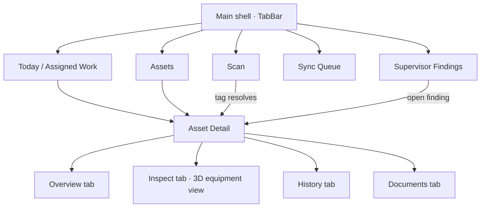
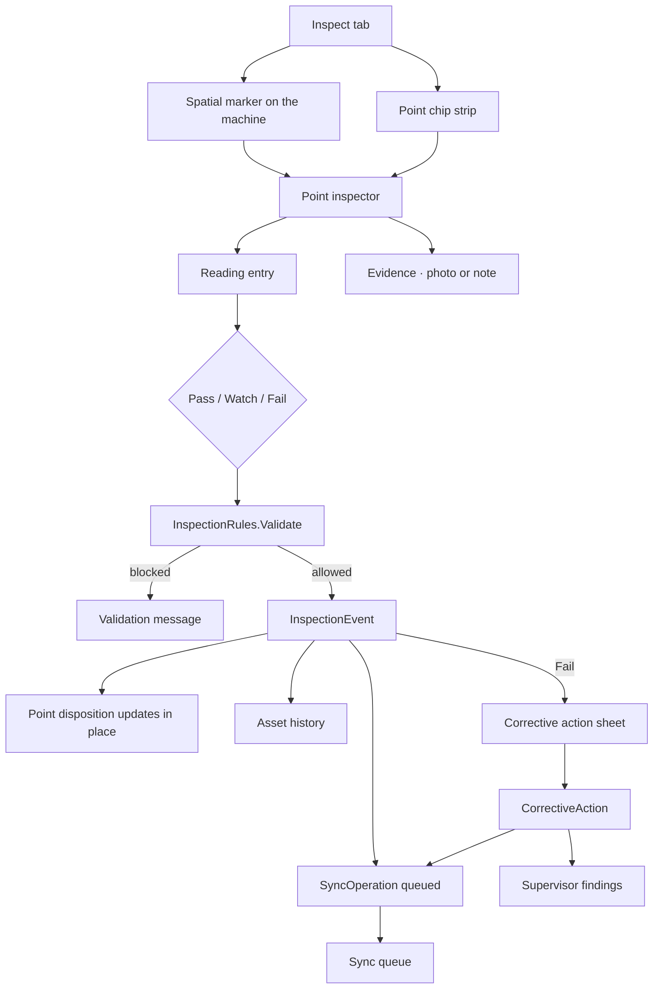

# TRACE — Implemented Design Graph

This records what the Uno app actually implements. Where it departs from the original
product package, the deviation is called out under "Deviations from the brief".

## Navigation

The shell has two `TabBar`s over one content region, and the width category picks one: a
bottom bar on a phone (Narrow, below 600) and a left rail from Normal (600) up. Both are
laid out once at launch, so crossing 600 (a phone turned to landscape) never navigates away
from the asset on screen. All five destinations are direct — there is no "More" overflow.

## Inspection flow

The inspector is one control, `PointInspector`, presented two ways: docked as a right-hand
panel from Wide (800; 360 wide, 400 from Widest at 1080), and as a bottom sheet below it. Reading entry, the three
dispositions, the validation message and Complete point live in a pinned footer so the
decision is never below the fold.

## The equipment view

The Inspect tab draws a real 3D model of the asset, not an illustration:

- Geometry comes from a glTF 2.0 file when the asset has one (`Asset.ModelUri`, loaded
  through `GltfEquipmentLoader`), and otherwise from parametric solids (revolve, box,
  tube, ring) built per `AssetKind`. The parametric model is also what shows until a file
  has loaded and what stays if it cannot be read. See `docs/REAL-ASSETS-SPEC.md`.
- Inspection points in a file are named, mesh-less nodes whose names are point ids, so
  the asset owns its own anchors. P-204 ships this way in `Assets/Models/p-204.glb`.
- An orbit camera frames the model by fitting its projected outline to the viewport, so the
  machine fills a phone panel and a desktop one equally.
- Lambert key light plus fill, sky and rim terms; backface culling; painter's-algorithm
  triangle sort; one `DrawVertices` call into a 2× supersampled surface.
- Drawn on the window's own Skia canvas through `SKCanvasElement` on every head that
  renders through Skia (desktop, Android, iOS, WebAssembly) — hardware-accelerated when
  the app is, with no intermediate bitmap. The WinAppSDK head does not render through
  Skia, so the view falls back to `SKXamlCanvas` (SkiaSharp.Views.WinUI) there; that
  fallback is compiled only into the WinAppSDK build (`#if WINDOWS`). Both surfaces feed
  the same renderer.
- Inspection points are 3D anchors on the solids. The renderer publishes where each one
  projected to, and a `NonVirtualizingLayout` places the XAML markers there, dimming the
  ones that turned to the far side. The markers stay ordinary focusable controls so the
  points remain reachable by keyboard and screen reader.

## Core design tokens

- Base spacing: 4 / 8 / 12 / 16 / 24 / 32 (and 2 between an overline and its title)
- Page sides: 16px on a phone, 24px from Normal; sheets 16px / 24px
- Content columns: 960px for lists and records, 1280px for Findings at Widest, 1600px for
  the asset workspace, 640px for the Scan form, 520px for the corrective-action sheet
- Field body: 15px
- Labels: 12–13px
- Display asset title: 22–28px
- Corner radius: 8px thumbnails and plates, 10px controls, 14px sheets, 18px cards
- Status roles: neutral / success / watch / failure / syncing
- Surface hierarchy: canvas → raised pane → interactive tile → transient sheet
- Minimum touch target: 44px

They map by value to the Material theme's tokens (on this theme `SpaceN00` is N × 8 px and
`RadiusN00` N × 4 px): spacing 2–24 is `Space025`–`Space300`, page and sheet sides
`Space200`/`Space300Thickness`, the touch target `ControlHeightMediumLarge` (44). Radii take the
nearest step above where the scale has no exact one: 8 → `Radius200`, 10 and 12 → `Radius300`,
14 → `Radius400`, 18 → `Radius500`. `Trace/Themes/Layout.xaml` keeps the widths and part sizes no
token covers; pages and controls reference keys, never literal values.

Colour comes from the Material theme: its palette is `Styles/ColorPaletteOverride.xaml` (every
role in Light and Default; Uno Platform Studio's Themes tab edits it), used through the role
brushes. Statuses: neutral is `SurfaceVariant`, failure the Error role, syncing the Secondary
container; success and watch are the app's own colours (App.xaml's `Success*` and `Watch*`), so a
status keeps its meaning whatever the brand colour. App.xaml also holds the other colours with no
role: the scrim (behind a sheet, and the 3D view's ground shadow) and the fill light. Both themes are first-class;
dark is the default for field use (an owner decision: TRACE does not follow the system theme).
Text roles carry their colour through Style setters rather than local `ThemeResource`
assignments, which do not re-resolve on a theme change. The equipment's own paint (cast
iron, steel, the yellow coupling guard) is App.xaml's `Equipment*Color`, the same in both themes;
a glTF model carries its own colours.

## Width categories

`utu:Responsive` on the Toolkit's default breakpoints; each page states its layouts at its top.

| | Narrow (< 600) | Normal (600–800) | Wide (800–1080) | Widest (≥ 1080) |
|---|---|---|---|---|
| Shell | bottom bar | rail | rail | rail |
| Today, Assets, Sync | one column, 16px sides | one column, 24px sides | same | column capped at 960, centred |
| Findings | two lists stacked | stacked | stacked | side by side, 1280 column |
| Scan | full-width form | 640 form, left | same | 640 form, centred |
| Asset | back row + full-width tabs; inspector as sheet | one header row; sheet | inspector docked at 360 | docked at 400; workspace capped at 1600 |

## Reusable patterns

- Page header (eyebrow / title / supporting / actions)
- Asset card
- Spatial point marker
- Reading capsule
- Disposition button (three equal, always-visible choices)
- Evidence tile
- Timeline event
- Status chip — every status carries a glyph and a label, never colour alone
- Count badge on a tab
- Action confirmation bar

## Interaction patterns

- Tap a marker or a point chip → open the point inspector
- Enter a reading → live range evaluation, out of range prompts an explicit disposition
  rather than forcing Fail
- Fail → requires a note or evidence before Complete point enables
- Complete → point state, history, sync queue and any corrective action all move together
- Drag the machine → orbit; far-side markers fade
- Offline → immediate local commit plus a queued operation; sync status is always explicit

## Deviations from the brief

- **Five direct tabs, no "More" overflow.** The brief grouped Scan, Sync and Findings behind
  an overflow. Five fit the rail and the bottom bar at every supported width, and hiding the
  sync queue behind a menu conflicts with the rule that sync status is never inferred.
- **A 3D equipment view, not an annotated illustration.** The brief described a spatial
  canvas; this implements it as genuine geometry the technician can turn.
- **Camera, scan, network and sync are simulated.** Each sits behind an interface in
  `Services/` with a deterministic implementation, including the camera-denied path, which
  the inspector exposes through a "Simulate denial" affordance since no hardware here will
  refuse the app.
